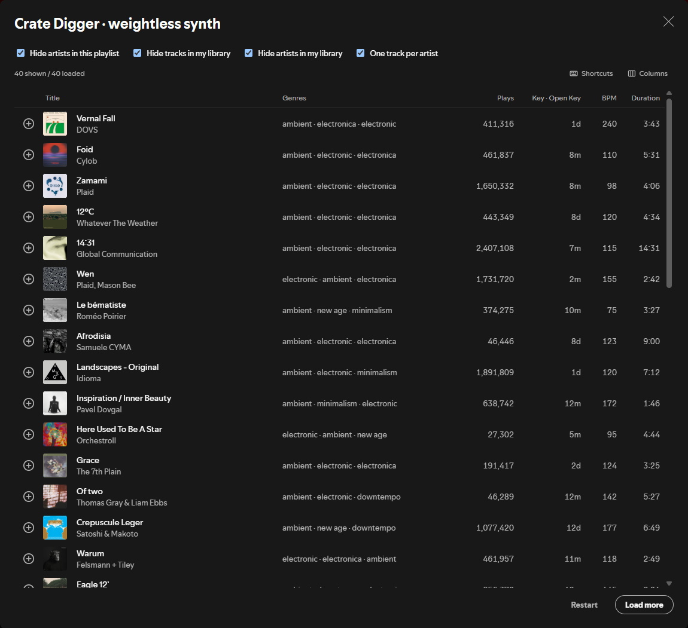

# Crate Digger

An extension for [Spicetify](https://spicetify.app) that allows you to find new tracks to add to your playlist.
A popup will appear when opening the extension, allowing you to browse hundreds of recommendations based on your
playlist and easily add them to it.



## Functionality

- **More recommendations!** Recommendations are made by combining your playlist's recommended tracks with other
  Spotify sources: autoplay, top tracks from related artists and playlists your artists were discovered on.
  **Load More** keeps digging for you.
- **Filtered by genre & sound.** Extra sources only make it in if they match your playlist's genres. All
  recommendations are then filtered so they match your playlist by **timbre and punch** (from Spotify's audio
  analysis). **Load More** keeps searching until 40 tracks have passed your filters and match your playlist. The
  profile is based on the last 100 tracks added to your playlist, so it reflects the direction your playlist is going.
- **Filtered based on your account.** You can hide artists already in your playlist, tracks you already have (in your
  playlists / liked songs), artists you already have, or show only one track per artist (a collaboration counts as an
  artist of its own). Tracks already in your playlist never appear.
- **Track info.** Genre (hover to see confidence levels), Plays, Key, BPM, Release Date and Duration. Choose which
  columns to show in the **Columns** menu; column widths resize to fit the available space. Keys can be displayed in
  Musical (Am), Camelot (8A) or Open Key (1m) format — click the **Key** column heading to change.
- **Designed for DJs.** The currently playing track is highlighted. Keyboard shortcuts let you seek, move through the
  list, play and add tracks without using the mouse.
- **Persistent.** When you close the popup and re-open it, all previously loaded tracks, filters and scroll position
  remain. The button turns green on playlists with an active session.
- **Randomised.** Every time you press **Restart**, different tracks are shown.

## Installation

You will need the Spotify desktop application and [Spicetify](https://spicetify.app/docs/getting-started).

### Via Spicetify Marketplace

Open the **Marketplace** in Spotify and search for **Crate Digger**. Click **Install**.

### Manual

1. Download [`crate-digger.js`](crate-digger.js).
2. Place it in the extensions folder:
   - **Windows:** `%APPDATA%\spicetify\Extensions`
   - **macOS / Linux:** `~/.config/spicetify/Extensions`

   If unsure, type `spicetify path userdata` into a terminal to see where your Spicetify folder is, and place the
   extension in its `Extensions` subfolder.
3. Enable & apply:

   ```bash
   spicetify config extensions crate-digger.js
   spicetify apply
   ```

Spotify will reload. A new button (a vinyl record) will appear next to Shuffle & Download on your playlists.

### Updating

Replace the `crate-digger.js` file in the extensions folder, then run `spicetify apply`.

### Uninstalling

```bash
spicetify config extensions crate-digger.js-
spicetify apply
```

## Usage

1. Open a playlist in Spotify.
2. Press **F8**, or click the **Crate Digger** button next to the play button (only appears on playlists you own),
   or right-click the playlist → **Crate Digger**.
3. Click a row to play it. Click **+** to add it to your playlist (only works on playlists you can edit).
4. Click **Load More** to continue digging. Click **Restart** to begin again with different tracks.

**Keyboard shortcuts** (while the popup is open; toggle them on/off in the **Shortcuts** menu):

| Key | Function |
|---|---|
| ← / → | Seek back / forward 10 s |
| ↑ / ↓ | Move the selection through the list |
| Enter | Play / pause the selected track |
| A | Add the selected track to your playlist |

When opened for the first time after Spotify starts, it takes a few seconds to load: it scans your library to
identify the tracks and artists you already have. No data is sent outside of Spotify.

## Troubleshooting

- **Spotify has been updated and the extension is missing.** Spotify updates remove Spicetify. Run
  `spicetify backup apply`.
- **Some columns are blank or fewer tracks appear.** The extension uses internal Spotify APIs, which may change when
  Spotify updates. Anything affected shows as "—" and everything else should keep working.


## Credits

Inspired by [Sort Play](https://github.com/hoeci/sort-play) (MIT) for reading Spotify's native track genre, key and
BPM information.

## Licence

[MIT](LICENSE)
